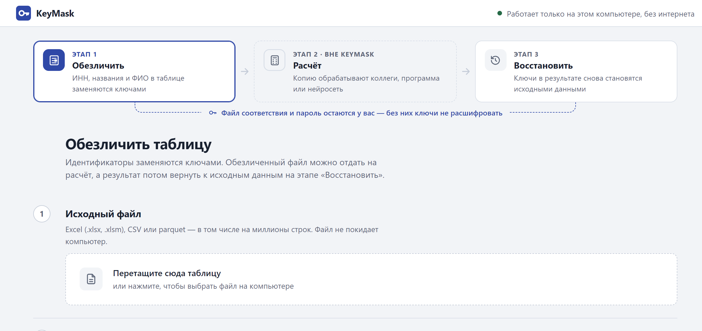
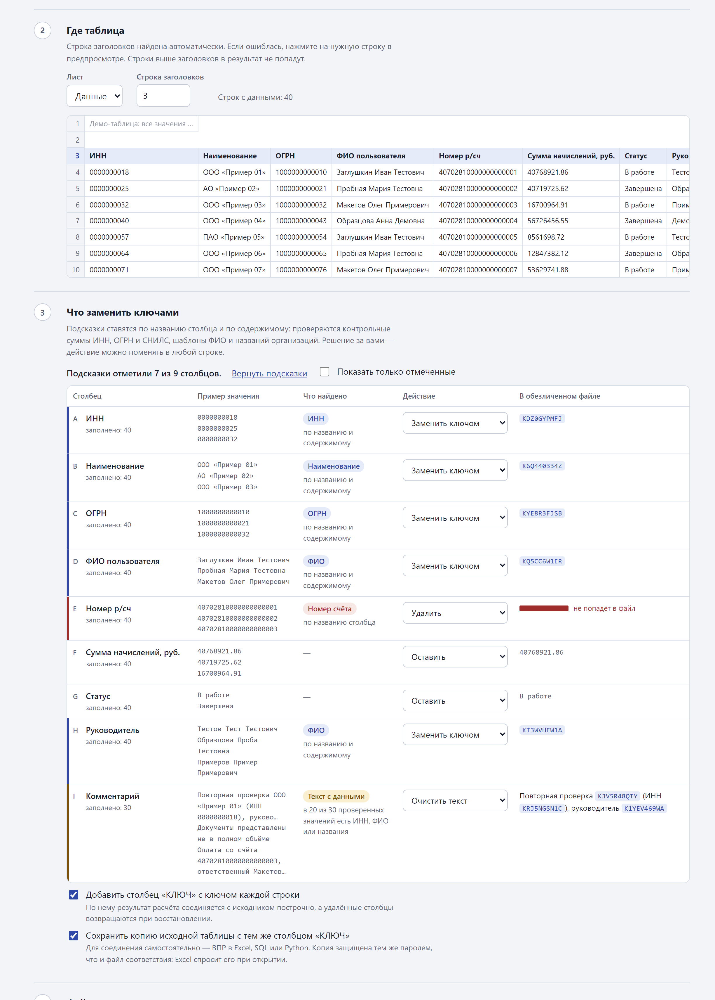
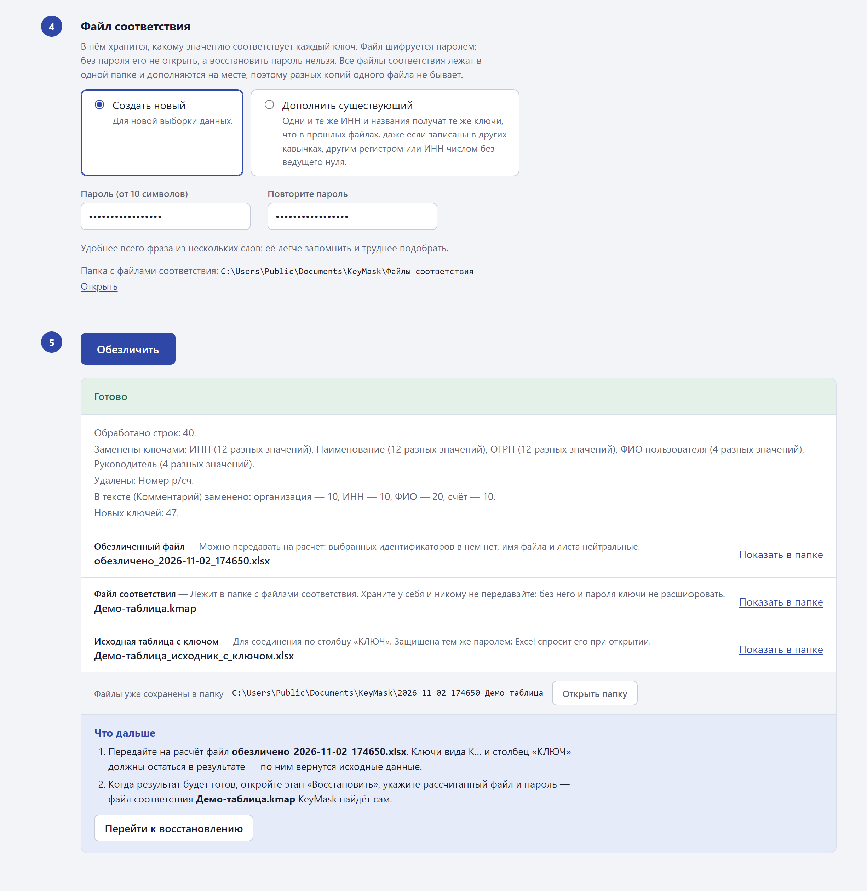
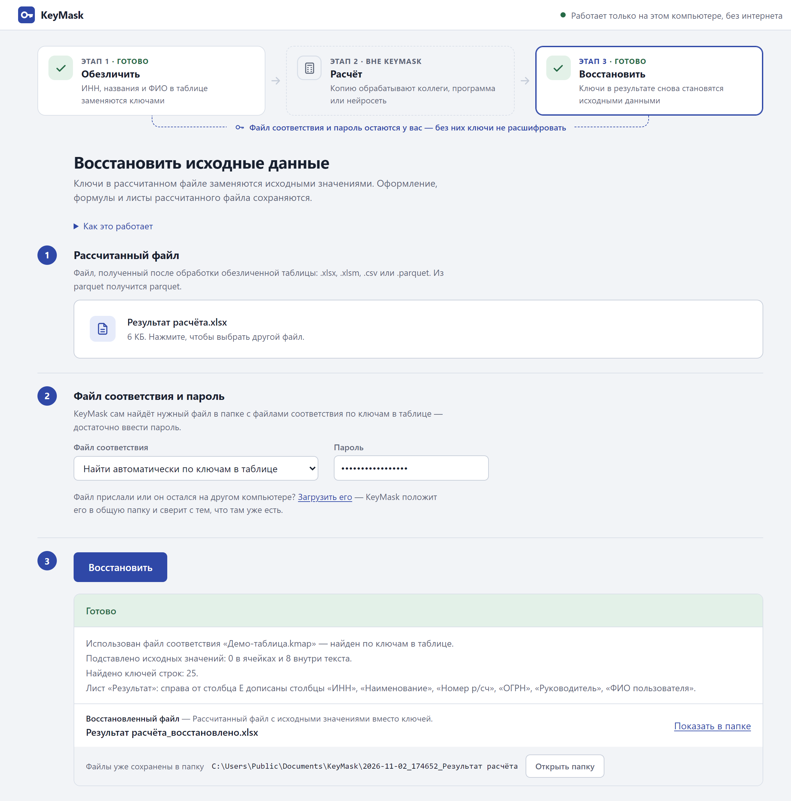
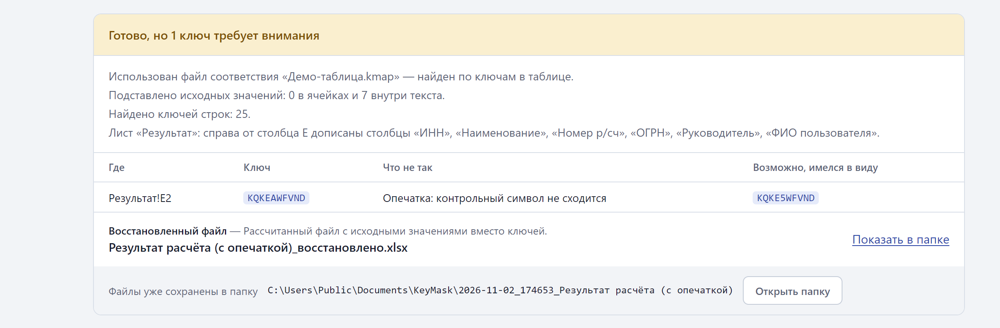

# KeyMask

KeyMask обезличивает таблицы Excel, CSV и parquet: заменяет ИНН, наименования, ОГРН, ФИО и другие идентификаторы случайными ключами. Обезличенную таблицу можно отдать на расчёт коллегам, в другую программу или ИИ-инструменту. Потом KeyMask возвращает в результат расчёта исходные значения по тем же ключам.

Программа работает только на вашем компьютере, без интернета: данные никуда не отправляются.

## Скачать

Последняя версия — на странице [Releases](https://github.com/veryrarebo/KeyMask/releases/latest). Там два архива с одинаковым содержимым:

- **KeyMask-Windows.zip** — открывается в Windows без дополнительных программ;
- **KeyMask-Windows.rar** — меньше по размеру, но в Windows 10 для него нужен WinRAR или 7-Zip.

## Установка

1. Распакуйте архив в любую папку.
2. Откройте папку `KeyMask` и дважды щёлкните `Установить.bat`.

Программа скопируется в вашу папку пользователя, на рабочем столе и в меню «Пуск» появится ярлык KeyMask, и программа сразу откроется. Права администратора и Python не нужны.

Нужна 64-разрядная Windows 10 или 11. Окно программы рисует встроенный в Windows движок WebView2 — он есть в Windows 11 и в обновлённой Windows 10. Если его нет, KeyMask откроется в браузере.

### Если Windows или антивирус предупреждают

Программа не подписана сертификатом разработчика, поэтому при первом запуске Windows может показать окно «Система Windows защитила ваш компьютер». Нажмите «Подробнее» → «Выполнить в любом случае». Корпоративный антивирус может заблокировать программу — тогда согласуйте исключение с ИТ-службой.

Проверить, что архив скачался без искажений, можно по контрольной сумме SHA-256 — она указана в описании релиза. В PowerShell: `Get-FileHash KeyMask-Windows.zip`.

## Как пользоваться

Вверху окна — три этапа. На снимках ниже — демо-таблица: все организации, ИНН, ОГРН и ФИО в ней вымышлены.

### Этап 1. Обезличить

Выберите таблицу. KeyMask сам найдёт строку заголовков и подскажет, какие столбцы похожи на идентификаторы: проверяет названия столбцов, контрольные суммы ИНН и ОГРН, шаблоны ФИО и названий организаций. Для каждого столбца выберите действие: оставить, заменить ключом, удалить или очистить текст. Справа видно, как столбец будет выглядеть в обезличенном файле.

Задайте пароль для файла соответствия — не короче 10 символов — и нажмите «Обезличить». KeyMask покажет, что заменено, и сохранит обезличенный файл, файл соответствия и защищённую паролем копию исходника.

Если результаты разных выгрузок потом нужно будет свести по ИНН — ВПР, сводной таблицей или в нейросети, — обезличивайте их одним файлом соответствия: для второго и следующих файлов выберите «Дополнить существующий». Одинаковые значения получат одинаковые ключи, а в итоге будет видно, сколько значений каждого столбца совпало с прошлыми файлами.

### Этап 2. Расчёт

Обезличенный файл можно обработать где угодно вне KeyMask: передать коллегам, в другую программу или ИИ-инструменту. Столбец «КЛЮЧ» и ключи вида `K…` должны остаться в результате — по ним вернутся исходные данные.

### Этап 3. Восстановить

Выберите рассчитанный файл и введите пароль — нужный файл соответствия KeyMask найдёт сам. Он подставит исходные значения вместо ключей, в том числе внутри текста, и допишет столбцы, которых в результате нет. Так же восстанавливается файл, сведённый из нескольких обезличенных: если в нём несколько столбцов «КЛЮЧ», одноимённые дописанные столбцы подписываются файлом, из которого пришли.

Если ключ исказили при расчёте — например, нейросеть заменила один символ, — KeyMask заметит это по контрольному символу и подскажет правильный ключ.

Результаты сохраняются в папку `Документы\KeyMask`, файлы соответствия — в `Документы\KeyMask\Файлы соответствия`.

## Важно

- **Файл соответствия и пароль храните у себя.** Без них ключи не расшифровать, а забытый пароль восстановить нельзя.
- Подсказки по столбцам работают по правилам и не гарантируют, что найдено всё. Просматривайте столбцы со свободным текстом сами.
- Обезличенные данные юридически остаются персональными: файл соответствия превращает их обратно. Перед передачей во внешние сервисы согласуйте схему со службой безопасности.
- Parquet обрабатывается до 10 млн строк. При обезличивании Excel и CSV читаются целиком в память, поэтому для больших таблиц лучше подходит parquet.

## Удаление

«Параметры → Приложения → KeyMask» или `Удалить.bat` в папке программы. Результаты в `Документы\KeyMask` остаются.

## Сторонние компоненты

В программу входят Python (лицензия PSF), Apache Arrow / pyarrow (Apache-2.0), cryptography (Apache-2.0 или BSD-3-Clause), OpenSSL (Apache-2.0), openpyxl (MIT), msoffcrypto-tool (MIT), pywebview (BSD-3-Clause) и pythonnet (MIT). Программа собрана PyInstaller (GPL-2.0 с исключением для собранных программ).

KeyMask распространяется как есть, без каких-либо гарантий.
